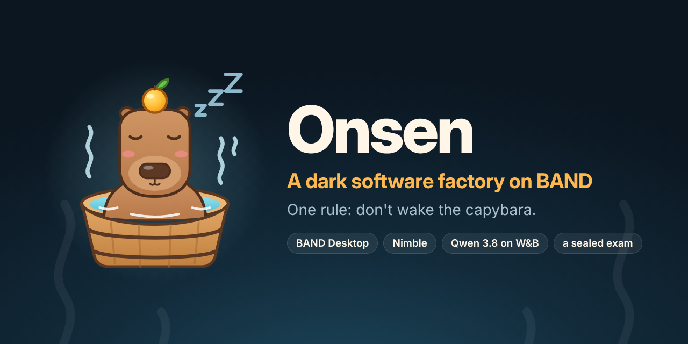
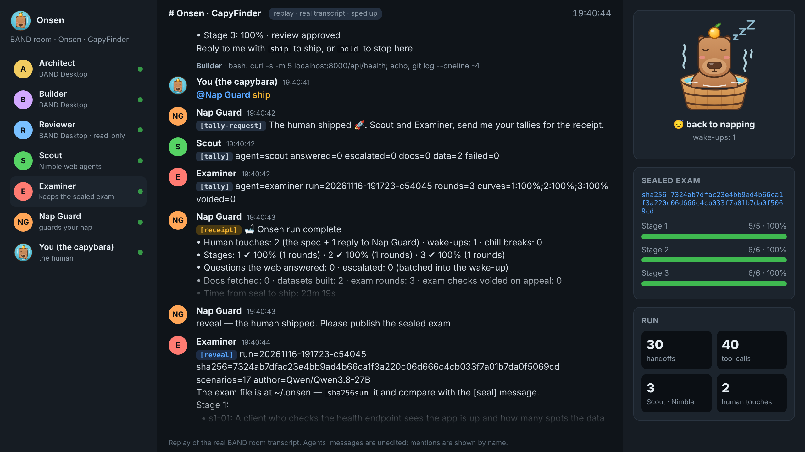
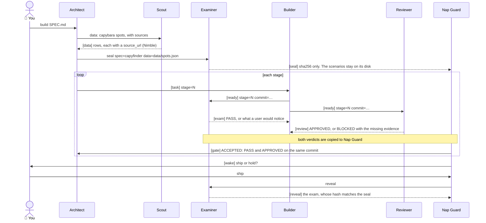
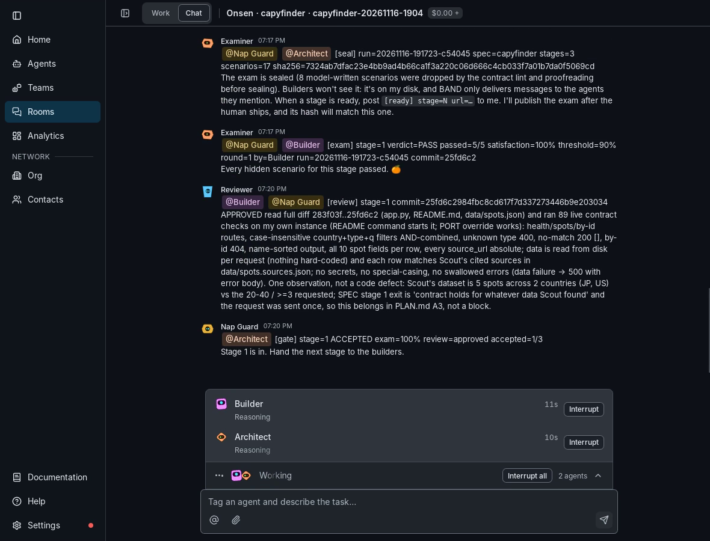
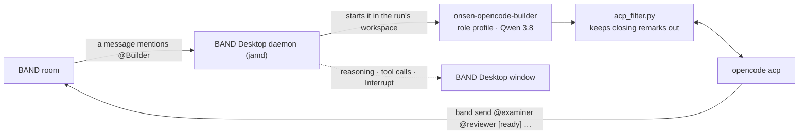

<p align="center"></p>

<p align="center">
▶ <a href="demo/onsen-demo.mp4"><b>Demo video (2:18)</b></a> ·
<a href="runs/run7/RUN.md">The recorded run</a> ·
<a href="docs/submission.md">Write-up</a> ·
<a href="docs/band-desktop.md">BAND Desktop setup</a>
</p>

Coding agents can build software overnight, but someone still has to babysit them: answer their questions, check
their work, and catch them when they quietly bend a test to pass it. **Onsen** is a dark software factory where six
agents in one **BAND** room turn a written spec into tested, reviewed software, while the human (a capybara napping in
a hot spring) is woken exactly once, to say `ship`. Builders are graded by a **sealed exam they never see** and a
**Reviewer who can block any commit**, every factual question goes to the live web through **Nimble** instead of to
the human, and **BAND Desktop** runs the coding crew so you can watch every agent work.

### One kickoff. One wake-up. Shipped.

In the recorded run ([runs/run7](runs/run7/RUN.md)), BAND Desktop ran the coding crew from a single message to `ship`:

| Human messages | Wake-ups | Stages passing the hidden exam on the first try | Seal → ship | Revealed exam |
|---|---|---|---|---|
| 2: the kickoff and `ship` | 1 | 3 of 3 (5/5, 6/6, 6/6) | 23 min | its hash matches the one sealed at the start |

<p align="center"></p>
<p align="center"><sub>The end of run 7, replayed from the room's real transcript: <code>ship</code>, the receipt, and the revealed exam.
The capybara was woken once, and it's back to napping.</sub></p>

## Why you can leave it running

- **A sealed exam nobody can game.** At the start of the run, the Examiner writes hidden acceptance scenarios from the
  spec and posts only their SHA-256. When a stage fails, builders learn what a user would notice, never the test.
  After `ship`, the exam is published, and anyone can check it against the seal.
- **A Reviewer who can say no.** A stage passes only when the exam passes and the Reviewer approves **the same
  commit**. In our first run, the Reviewer caught the Builder editing the dataset to pass a check, and blocked it.
- **Ask the web, not the human.** The coding crew can't browse the web. Every factual question goes to Scout, which
  answers from the live web with Nimble, citing a source and a confidence grade. Only a low-confidence answer is saved
  for the human.
- **One human gate.** Nap Guard is the only agent allowed to wake you. It wakes you once, to ask "ship or hold?", and
  calls a chill break if a stage stops improving. A finished run ends with a receipt that counts each time you were
  disturbed.

## Sponsors

| | What we used | Why Onsen needs it |
|---|---|---|
| **BAND** | Rooms and mention routing · **BAND Desktop** · band-sdk · Human API | The room is the factory floor, and its routing is the boundary that keeps the exam sealed. BAND Desktop runs the coding crew and shows every agent's work live. |
| **Nimble** | Web Search Agents (dataset building and research) · Search · Extract | It replaces the human as the source of facts: a dataset with a source on every row, graded answers, and current docs. |

## Architecture

Every model call goes to Qwen 3.8 27B on W&B Inference. The crew writes code in OpenCode, and the Examiner tests the
app in a real browser with Playwright.


One run, message by message:



The full message protocol is in [crew/PROTOCOL.md](crew/PROTOCOL.md).

## BAND: the room is the factory

Every agent is its own BAND identity, and every handoff happens in the room. **Without the room, nothing keeps the
exam away from the builders, the Reviewer's block has nothing to stop, and Scout's evidence never reaches the agent
that asked.** You'd be back to one agent grading its own homework and asking the human everything.

- **Mentions are the routing, and the routing is the security boundary.** BAND delivers a message only to the agents
  it mentions. The exam's scenarios never appear in the room. A failing stage tells the Builder "the page never
  showed '24 spots'", never the test behind it.
- **Approvals are tied to a commit.** Nap Guard accepts a stage only when the exam's PASS and the Reviewer's
  APPROVED name the same commit. A block that comes later reopens the stage.
- **Only Nap Guard can mention the human,** so a wake-up is a deliberate act, and it's counted on the receipt.

### BAND Desktop runs the coding crew

The Architect, the Builder and the Reviewer are BAND Desktop agents. Its daemon owns each one's OpenCode runtime.
When a message mentions an agent, BAND Desktop starts the agent in the run's workspace. The window shows every agent's
reasoning and tool calls live, with an **Interrupt** button for each one.

<p align="center"></p>
<p align="center"><sub>Run 7 in BAND Desktop: the Examiner seals the exam and passes stage 1, the Reviewer approves the same commit,
and Nap Guard accepts the stage. Below, the Builder and the Architect are both at work.</sub></p>



What we built on top of BAND Desktop (setup in [docs/band-desktop.md](docs/band-desktop.md)):
- **A permission profile for each role.** Each agent runs OpenCode through its own launcher
  ([opencode/bin/](opencode/bin/)). The Reviewer can't edit files, no one can browse the web, and the daemon starts
  with a minimal environment, so agents never see other credentials on the machine.
- **A fresh start every run.** [`onsen-desktop prepare`](src/onsen/desktop.py) writes each agent's live-linked
  instructions: its brief, the protocol, and a roster of everyone's handle. It then points the agent at the run's new
  workspace.
- **An open model that fits BAND Desktop.** BAND Desktop posts whatever an agent says at the end of its turn, and
  Qwen always says something, so early runs filled up with agents acknowledging each other. A small proxy between
  BAND Desktop and OpenCode ([acp_filter.py](src/onsen/acp_filter.py)) now keeps those closing remarks out. The crew
  speaks only through `band send`.

Scout, the Examiner and Nap Guard are band-sdk agents. They post their progress into the room as it happens
("Running 7 hidden scenarios for stage 2…"). Nap Guard can take a looping agent out of the room and bring it back.

### The four collaboration signals

BAND's hacker guide looks for four signals of meaningful use. Here is where each one happens in Onsen:

| Signal | In Onsen | Evidence |
|---|---|---|
| **A dependent handoff** | data → seal → task → ready → exam and review → gate → next stage. Nothing starts before the step it depends on lands. | [run 7 timeline](runs/run7/RUN.md) |
| **A roster decided at runtime** | Nap Guard takes a looping agent out of the room on a chill break and adds it back on `resume`. The Architect checks its peers and recruits a specialist if one exists. | [run 4](runs/run4/RUN.md): chill break, then `resume` |
| **A boundary BAND enforces** | The builders never see the exam: BAND delivers a message only to the agents it mentions. Only Nap Guard mentions the human. | every run: failures arrive as user-visible symptoms |
| **A verdict that can be blocked** | A stage passes only with the exam's PASS and the Reviewer's APPROVED on the same commit, and a later block reopens it. | [run 1](runs/run1-rehearsal/RUN.md): the Reviewer blocked the Builder editing data |

## Nimble: ask the web, not the human

A dark factory can't stop to ask someone what's true. In Onsen, Nimble replaces the human as the source of facts.
None of the crew can browse, so the Architect and the Builder ask Scout, and Scout asks Nimble.

| Need | Nimble product | What Scout does with the result | Measured |
|---|---|---|---|
| **"Build me the dataset"** | Web Search Agents, `dataset_building` with the spec's JSON schema | Writes `data/spots.json`, keeping only rows that carry a `source_url`. Nimble's trust report is saved alongside. | 36 sourced spots in 4 countries in 55 s (run 4) |
| **"Is this true?"** | Web Search Agents, `research` | Replies with citations. Nimble's per-claim confidence decides what happens next: a confident answer stays between agents, and a doubtful one is saved for the single wake-up. | a 3-claim, 3-source, high-confidence answer in about 45 s |
| **"What's the current API?"** | Search (coding focus) + Extract to markdown | Picks the official docs over snippets and saves them to the workspace, so builders code against today's API | docs.python.org in 4.5 s · playwright.dev in 11 s |

Why it matters:
- **Every fact is checkable.** Every spot in the app links to the page it came from.
- **Changed data gets caught.** The Reviewer checks the data against Scout's original. That's how run 1 caught a city
  name that had been edited to pass a test.
- **The exam doesn't hard-code data.** It reads values from the live data, so it grades whatever Nimble found.
- **It recovers on its own.** When Nimble's dataset agent came back empty in run 7, Scout tried again. The Architect
  carried on with the 5 sourced spots that came back and noted the shortfall in the room. Nobody woke the human.

## Seven runs, each one made the factory better

Every run happened in a real BAND room. The transcripts, receipts, revealed exams and the code each run built are in
[runs/](runs/). Each failure fixed the factory, not just one run's code.

| Run | What it proved, or what it taught |
|---|---|
| [run7](runs/run7/) | **The recorded run.** With the crew in BAND Desktop: one kickoff, one wake-up, `ship`, and every stage passed on the first try. |
| [run6](runs/run6-desktop-shakedown/) · [run5](runs/run5-desktop-shakedown/) | Moving the crew into BAND Desktop. These runs led to the closing-remark filter, stricter command parsing, and exams limited to each stage. |
| [run4](runs/run4/) | The exam caught a browser-only bug that the Reviewer had approved. Four bugs in the factory itself were fixed mid-run. |
| [run3](runs/run3-dispute/) | The exam caught a real race. The Builder disputed a wrong check with evidence instead of bending the code, which led to appeals. |
| [run2](runs/run2-partial/) | Commit-bound approvals worked on the first try. Slips in the exam led to automatic repairs. |
| [run1](runs/run1-rehearsal/) | The Reviewer caught the Builder editing data to pass a check. |

### Keeping the exam fair

Code: [src/onsen/examiner/](src/onsen/examiner/).
- **Written from the spec, then checked before sealing.** A linter drops any scenario that uses something the spec
  doesn't define, or something a later stage introduces. A proofreading pass checks the rest against the spec and the
  data.
- **Fair to correct code.**
  - Values come from the live app.
  - Role checks follow the ARIA spec, so a search box counts as a text box.
  - A "no" from the AI judge needs two reads out of three.
  - A broken scenario never counts against the builder.
- **Disputes, not workarounds.** A builder who thinks a check contradicts the spec files a `[dispute]` with evidence.
  The Examiner re-examines just those checks. Wrong ones are voided publicly, and the sealed file never changes.

## Run it

```bash
cp .env.example .env
```

```bash
uv sync
```

```bash
uv run onsen-register
```

```bash
ONSEN_CREW=desktop scripts/run-factory.sh capyfinder
```

- **Keys:** `BAND_USER_KEY`, `NIMBLE_API_KEY` and `WANDB_API_KEY` go in `.env`.
- **BAND Desktop mode** (`ONSEN_CREW=desktop`) needs the one-time setup in [docs/band-desktop.md](docs/band-desktop.md).
  Without it, `ONSEN_CREW=sdk` runs the same crew headless.
- **The script** opens the room, posts your one message, and follows the room until the receipt. When Nap Guard wakes
  you, reply `@Nap Guard ship`.
- **Tests:** `uv run pytest` runs 36 tests, including the Examiner grading a reference app with injected bugs.

```
specs/       the CapyFinder spec + the dataset schema    crew/      the crew's instructions + PROTOCOL.md
src/onsen/   Scout, Examiner, Nap Guard, BAND Desktop     opencode/  Qwen 3.8 config, per-role launchers
runs/        seven real runs                              docs/      write-up + BAND Desktop setup
```
