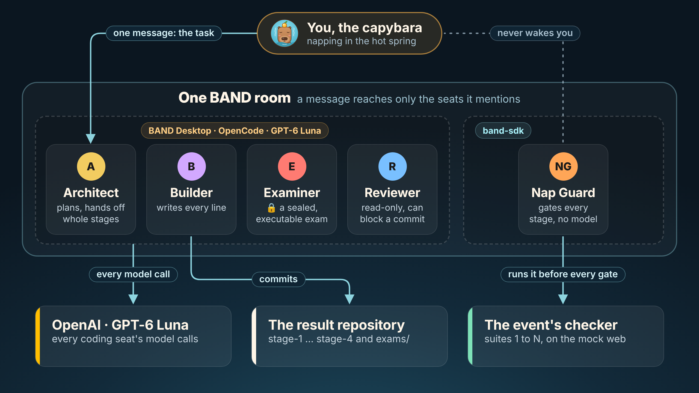

<p align="center"></p>

<p align="center">
<a href="https://github.com/chinesepowered/hack-band-dossier"><b>The Dossier entry</b></a> ·
<a href="https://github.com/chinesepowered/hack-band-dossier/blob/main/FACTORY.md">FACTORY.md</a> ·
▶ <a href="demo/onsen-demo.mp4">Demo video</a> ·
<a href="demo/onsen-slides.pdf">Slides</a> ·
<a href="docs/practice-runs.md">Every practice run</a>
</p>

**Onsen is a dark software factory on BAND with one rule: don't wake the capybara.** The human dispatches one task
and goes back to sleep. Five seats in one BAND room take it from there: an Architect that hands off whole stages, a
Builder, an Examiner that keeps its own sealed, executable exam, a read-only Reviewer, and Nap Guard, a seat with no
model that gates every stage and runs the event's acceptance checker itself. Nobody asks the human anything.

<p align="center"></p>

## The judged run

Run U, on factory commit [`defe350`](https://github.com/chinesepowered/hack-darkband/tree/defe350): **all four
stages accepted, from one human message, in 5 hours 14 minutes, for $9.60 of model spend.** Wake-ups: 0.

| Stage | Accepted after | Event's checker on the accepted commit | The band's own exam |
|---|---|---|---|
| 1 · company profiles | 91 min | claims stage 1 (stage-1 suite 120/122) | 96% (passed) |
| 2 · competing sources and the screens | 96 min | claims stage 2 (stage-2 suite 11/12) | 77% |
| 3 · change over time | 63 min | claims stage 3 (stage-3 suite 7/9) | 65% |
| 4 · independent sources, batches, failures | 64 min | claims stage 4 (stage-4 suite 8/10) | 67% |

The Builder made 142 commits; the Examiner graded 23 handoffs against exams it sealed before any build; the Reviewer
blocked 22, each on a file and line; Nap Guard ran the event's checker before each of its 4 gates. The run showed six
weaknesses, each fixed afterwards on this repository's `main` (listed under
[After the judged run](https://github.com/chinesepowered/hack-band-dossier/blob/main/FACTORY.md#after-the-judged-run));
`defe350` is the factory exactly as it ran. On a fresh clone of the entry, the event's harness in isolated mode has every
stage folder claim its stage on the shipped checks (96%, 92%, 78% and 80% of their own suites).

The entry, with the band's code, its git history, the room log and the published exams, is
[chinesepowered/hack-band-dossier](https://github.com/chinesepowered/hack-band-dossier). Its
[`FACTORY.md`](https://github.com/chinesepowered/hack-band-dossier/blob/main/FACTORY.md) explains the design, the
setup, the costs and what failed on the way.

## What's in this repository

| Path | What it is |
|---|---|
| [`mandates/`](mandates/) | one mandate per seat; a run copies them into its result repository |
| [`crew/PROTOCOL.md`](crew/PROTOCOL.md) | the room protocol every seat follows: tags, owners, one verdict per commit |
| [`src/onsen/napguard.py`](src/onsen/napguard.py) | Nap Guard: recounts each exam, needs the review on the same commit, runs the checker, escalates stalls |
| [`src/onsen/quietwatch.py`](src/onsen/quietwatch.py) | Nap Guard's watch on the room: a quiet room, a late handoff, a closed stage, a stuck turn |
| [`src/onsen/acp_filter.py`](src/onsen/acp_filter.py) | the proxy between BAND Desktop and OpenCode: drops closing remarks, keeps a working seat going |
| [`src/onsen/desktop.py`](src/onsen/desktop.py) | writes each seat's instructions and points its runtime at the run |
| [`bin/`](bin/) | the seats' tools: `band` (the room linter), `onsen-check`, `onsen-serve`, `onsen-exam`, `onsen-shot`, `onsen-split` |
| [`opencode/`](opencode/) | each seat's launcher, the OpenCode config, the git hooks that keep graders from committing |
| [`scripts/run-dark.sh`](scripts/run-dark.sh) | one dark run: a fresh room with the five seats, Nap Guard, and the task as the only human message |
| [`scripts/`](scripts/) | the run's facts, the live dossier, and the video, slides and images |
| [`tests/`](tests/) | tests for Nap Guard, its watch, the proxy and the linter |
| [`docs/practice-runs.md`](docs/practice-runs.md) | every run on Dossier, what went wrong, what changed, and every human-side action |

## Run it

Set up BAND Desktop, OpenCode and the five seats once ([`docs/band-desktop.md`](docs/band-desktop.md), or the
[Setup](https://github.com/chinesepowered/hack-band-dossier/blob/main/FACTORY.md#setup) section of `FACTORY.md`).
Then a run is one command and one task file (what to build, the spec files, the result repository, the time budget):

```bash
scripts/run-dark.sh <result repository> <task file> "Onsen · Dossier"
```

It opens a fresh room with the five seats, starts Nap Guard and its watch, points every seat at the repository, and
posts the task as the only human message. Nothing in the mandates, the protocol or Nap Guard names the Dossier spec:
the task file and the event's checker (`ONSEN_CHECKER_DIR`, `ONSEN_TRACK`) are all a new spec needs. A run ends with
the Architect's `[report]` and Nap Guard's receipt.

## Before the buildathon

Onsen began as a human-gated factory on a spec of our own (CapyFinder): a Scout seat that asked the live web through
Nimble, an Examiner that wrote scenario exams, and a human who was woken once, to say `ship`. The event's autonomy
rule turned it into the dark factory above. That earlier version's write-up, runs and video are kept in
[`docs/submission.md`](docs/submission.md), [`runs/`](runs/) and [`demo/capyfinder-demo.mp4`](demo/capyfinder-demo.mp4).
