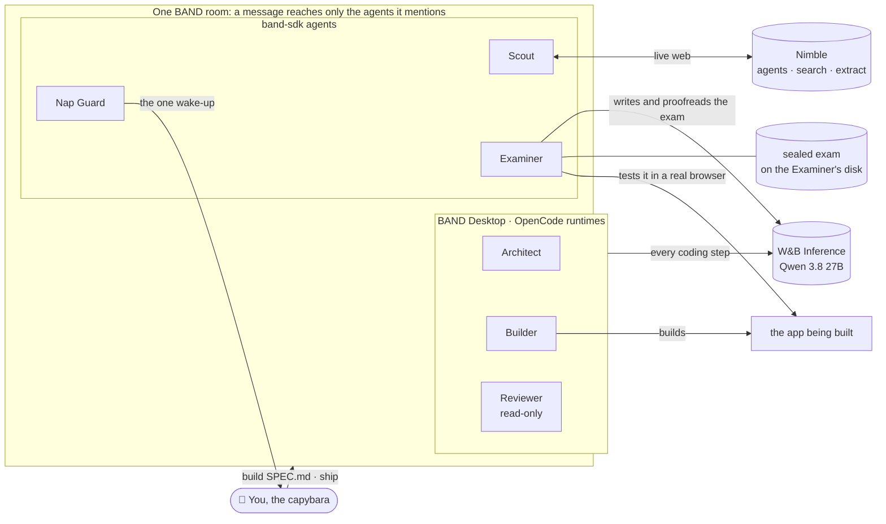
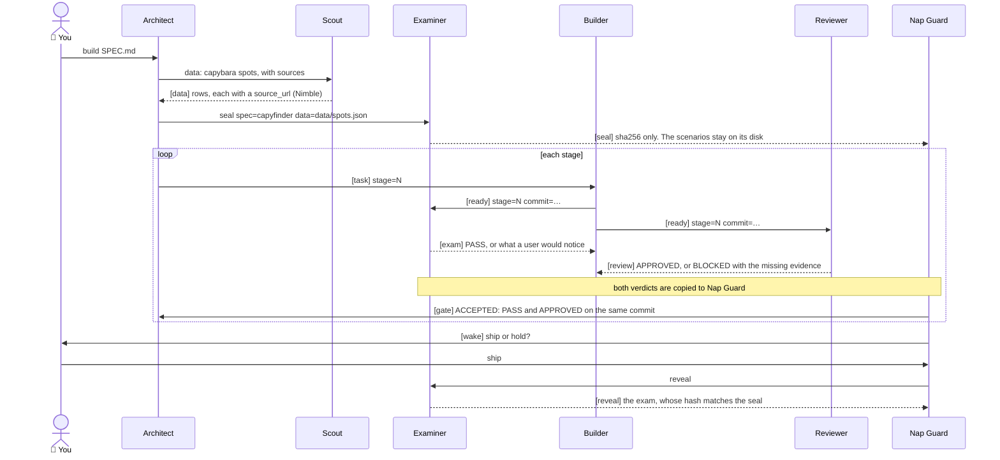
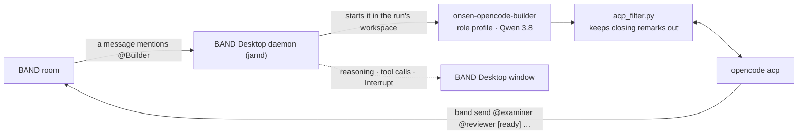

<p align="center"></p>

<h1 align="center">Onsen 🛁</h1>

<p align="center"><b>A dark software factory on BAND with one rule: don't wake the capybara.</b></p>

<p align="center">
▶ <a href="demo/onsen-demo.mp4"><b>Demo video (2:18)</b></a> ·
<a href="runs/run7/RUN.md">The recorded run</a> ·
<a href="docs/submission.md">Write-up</a> ·
<a href="docs/band-desktop.md">BAND Desktop setup</a>
</p>

AI coding agents can work through the night, but someone still has to answer their questions, check their work and
decide when it's done, and an agent that grades its own work will bend the test to pass it. **Onsen** is a dark
software factory on BAND: six agents in one room turn a written spec into tested, reviewed software, and the human (a
capybara napping in a hot spring) is woken once, to say `ship`. Questions go to the live web through **Nimble** instead
of the human, and each stage must pass a **sealed exam the builders never see**, kept hidden by BAND's message
routing, plus a **Reviewer** who can block the exact commit. In the recorded run, **BAND Desktop** ran the coding crew
from one kickoff message to `ship` with a single wake-up.

**The recorded run** ([runs/run7](runs/run7/RUN.md)):

| Human touches | Wake-ups | Stages passing the hidden exam on round 1 | Seal → ship | Revealed exam |
|---|---|---|---|---|
| 2 (the kickoff and `ship`) | 1 | 3 of 3 (5/5, 6/6, 6/6) | 23 min | hashes to the fingerprint sealed at the start |

## Sponsors

| Sponsor | What we used | Its job in Onsen | Code |
|---|---|---|---|
| **BAND** | BAND rooms · **BAND Desktop** 0.4.18 · band-sdk 9.2.1 · Human and Agent APIs | The factory floor: six agent identities in one room, with routing that keeps the exam sealed. BAND Desktop runs the coding crew and shows its work live. | [desktop.py](src/onsen/desktop.py) · [acp_filter.py](src/onsen/acp_filter.py) · [opencode/bin/](opencode/bin/) · [napguard.py](src/onsen/napguard.py) · [examiner/](src/onsen/examiner/) |
| **Nimble** | Web Search Agents (`dataset_building` with a JSON schema, and `research`) · Search · Extract | Replaces the human as the source of facts: a dataset with a source on every row, graded answers, and current docs. | [nimble_tools.py](src/onsen/nimble_tools.py) · [scout.py](src/onsen/scout.py) |

Other tools, not event sponsors:
- [W&B Inference](https://wandb.ai/site/inference) serves **Qwen 3.8 27B**, which handles every LLM call.
- [OpenCode](https://opencode.ai) is the crew's coding runtime.
- Playwright runs the exam in a real browser.
- ElevenLabs narrates the demo video.

## Architecture

**What runs where**



**One run, message by message**



- Every arrow between agents is a BAND message, and it reaches only the agents it mentions. The protocol is in
  [crew/PROTOCOL.md](crew/PROTOCOL.md).
- **The exam never travels as a message.** It stays on the Examiner's disk, and builders only hear what a user would
  notice. After `ship`, the Examiner publishes it, and anyone can check its hash against the seal.
- **Nap Guard is the only agent that mentions the human.** If a stage stops improving, it calls a chill break: it
  takes the looping agent out of the room and wakes you to `resume` or `hold`.

## BAND

BAND is the factory floor. Every agent is its own BAND identity, and the room carries every handoff.

### The room is the boundary

- **Mentions are the routing.** BAND delivers a message only to the agents it mentions. That's how the exam stays
  sealed: its scenarios never appear in the room, and an `[exam] FAIL` tells the Builder what a user noticed ("the
  page never showed '24 spots'"), never the test.
- **Commit-bound approvals.** Nap Guard accepts a stage only when the exam's PASS and the Reviewer's APPROVED name the
  same commit. A block that comes after acceptance reopens the stage.
- **One human gate.** Only Nap Guard may mention the human. It batches every open question into one wake-up ("ship or
  hold?"), or calls a chill break if a stage thrashes.

### BAND Desktop runs the coding crew

The Architect, the Builder and the Reviewer run inside **BAND Desktop** (0.4.18, the Linux package). Its daemon owns
each agent's OpenCode runtime: when a message mentions the agent, BAND Desktop starts OpenCode in the run's workspace,
hands it the message, and shows its reasoning and tool calls in the room live, with an **Interrupt** button for each
agent.



How we set it up (full steps in [docs/band-desktop.md](docs/band-desktop.md)):
- **Adopted, not recreated.** `band adopt` moved the three crew agents into BAND Desktop with their existing
  identities. Each got an OpenCode runtime in its Runtime tab: a per-role launcher
  ([opencode/bin/](opencode/bin/)) that loads Qwen 3.8 and the role's permission profile, so the Reviewer can't edit
  files.
- **Every run gets fresh instructions and a fresh workspace.** `onsen-desktop prepare` writes each agent's live-linked
  instructions (its brief, the protocol, and a roster of handles), then points its runtime at the new workspace
  (`band runtime template set --spawn-cwd … --apply-and-restart`).
- **The crew talks with `band send`.** The Builder's `[ready]` goes to the Examiner and the Reviewer in one message:
  `band send <room> "@…/examiner @…/reviewer [ready] stage=1 …"`.

Two things we built to make BAND Desktop work for an unattended factory:
- **A closing-remark filter.** BAND Desktop posts the text an agent ends its turn with as a reply to whoever woke it,
  and Qwen 3.8 always ends with some ("." or "No reply needed."). In runs 5 and 6 that caused acknowledgment
  ping-pong and loops. [acp_filter.py](src/onsen/acp_filter.py) is a small proxy between BAND Desktop and
  `opencode acp`. It passes everything through, except a turn's closing text that isn't a protocol message.
- **A minimal daemon environment.** The daemon passes its own environment to every agent runtime, so
  [band-desktop-daemon.sh](scripts/band-desktop-daemon.sh) starts it with only the W&B key and network settings.

### band-sdk and the APIs

- **Scout, the Examiner and Nap Guard** are band-sdk `SimpleAdapter` agents: deterministic code that calls Nimble or
  Qwen. They:
  - reply with `send_message` and explicit mentions;
  - stream progress into the room with `send_event` ("Running 7 hidden scenarios for stage 2…");
  - stay silent with `no_reply`;
  - on a chill break, take the looping agent out of the room with `remove_participant`, and add it back with
    `add_participant` on `resume`.
- **The Human API** registers the six agents (`onsen-register`), opens each run's room with the crew and posts the one
  kickoff (`onsen-kickoff`), and carries the human's `ship` (`onsen-say`). The Agent API's `/agent/me` gives the
  handles for the crew's roster.

### The four collaboration signals

BAND's hacker guide judges meaningful use by four signals. This is where each happens in Onsen:

| Signal | In Onsen | Evidence |
|---|---|---|
| **A dependent handoff** | data → seal → task → ready → exam and review → gate → next stage. Nothing starts before the step it depends on lands. | [run 7 timeline](runs/run7/RUN.md) |
| **A roster decided at runtime** | Nap Guard takes a looping agent out of the room on a chill break and adds it back on `resume`. The Architect looks up its peers and recruits a specialist if one exists. | [run 4](runs/run4/RUN.md): chill break, then `resume` |
| **A boundary BAND enforces** | The builders never see the exam: BAND delivers a message only to the agents it mentions. Only Nap Guard may mention the human. | every run: failures arrive as user-visible symptoms |
| **A verdict that can be blocked** | A stage passes only with the exam's PASS and the Reviewer's APPROVED on the same commit. A later block reopens it. | [run 1](runs/run1-rehearsal/RUN.md): the Reviewer blocked the Builder editing data to pass a check |

## Nimble

Nimble is how the factory runs without waking the human: Scout replaces the human as the source of facts. Agents ask
Scout instead of asking you, and only a low-confidence answer is ever saved for the human.

| Need | Nimble product | What Scout does with the result | Measured |
|---|---|---|---|
| "Build me the dataset" (the Architect, once per run) | **Web Search Agents**, `use_case="dataset_building"` with the spec's JSON schema | Writes `data/spots.json`. Rows without a `source_url` are dropped, and every schema field is present. The trust report and sources go to `.sources.json`. An empty result is retried after a pause. | Run 4: 36 sourced spots in 4 countries in 55 s. Run 7: empty twice, then 5 sourced spots |
| "Is this true? What's the convention?" | **Web Search Agents**, `use_case="research"` | Replies with citations. A confident answer (a high-confidence claim from a primary source, or a medium or better overall grade) stays between agents. A low-confidence one is copied to Nap Guard and saved for the single wake-up. | `confidence=high claims=3 sources=3` in about 45 s |
| "What's the current API?" | **Search** (`focus="coding"`, with a general search as fallback) + **Extract** to markdown | Ranks official docs above snippets and saves the page to the workspace's `docs/vendor/`, so builders code against today's API | docs.python.org page in 4.5 s; playwright.dev page in 11 s |

Why it matters for a dark factory:
- **Every fact is checkable.** Every spot in the app links to the page it came from.
- **Changed data gets caught.** The Reviewer checks rows against Scout's data. In run 1 it caught a city that had
  been edited to pass a test.
- **The exam doesn't hard-code data.** It captures values from the live data, so it works with whatever Nimble finds.

In the recorded runs, the dataset request was the only web lookup the crew needed. Research and docs were exercised
live in test rooms.

## Results: seven real runs

Every run happened in a real BAND room. Cleaned transcripts, receipts, revealed exams and the code each run built are
in [runs/](runs/). Each failure taught the factory something, and the fix went into the factory, not one run's code.

| Run | What it shows |
|---|---|
| [run7](runs/run7/) | **The recorded run**, with the crew in BAND Desktop: one kickoff, one wake-up, `ship`. Every stage passed its hidden exam on round 1, and the revealed exam matches the seal. |
| [run6-desktop-shakedown](runs/run6-desktop-shakedown/) | BAND Desktop posts every closing remark, and Qwen can't end a turn silently. This led to the closing-remark filter, plus a Scout retry for empty datasets. |
| [run5-desktop-shakedown](runs/run5-desktop-shakedown/) | The first BAND Desktop run: an agent's remark re-sealed the exam, and stage 1 was examined on stage 2's page. This led to stricter command parsing and stage-scoped exams. |
| [run4](runs/run4/) | The exam caught a browser-only bug the Reviewer had approved. Four factory bugs caused a chill break and were fixed live. The receipt is honest: 4 touches, 2 wake-ups. |
| [run3-dispute](runs/run3-dispute/) | The hidden exam caught a real race, and the per-commit gate held. The Builder disputed a bad check with evidence, which led to appeals. |
| [run2-partial](runs/run2-partial/) | Stages 1–2 passed on the first try with commit-bound approvals. Stage 3's exam slips led to automatic repairs. |
| [run1-rehearsal](runs/run1-rehearsal/) | The Reviewer caught the Builder editing data to pass a bad check. This led to per-commit gates, reopening and disputes. |

## How the sealed exam stays honest

Code: [src/onsen/examiner/](src/onsen/examiner/).

- **Written from the spec.** Qwen writes scenarios in a small executable language: HTTP checks, plus browser steps
  that use the labels, roles and test ids from the spec's acceptance contract. The output is constrained to a JSON
  schema.
- **Checked before sealing.**
  - A repair pass fixes common slips.
  - A contract linter drops any scenario that uses a route, field, label or text the spec doesn't define, or a route
    a later stage introduces.
  - A proofreading pass checks the exam against the spec and the data profile.
- **Sealed.** The file is hashed at seal time and re-checked before every grading. Only Nap Guard or a human can
  trigger the reveal.
- **Fair to builders.**
  - Values are captured from live responses.
  - Role checks follow ARIA (a search box counts as a text box).
  - An LLM judge's "no" needs two of three reads.
  - A scenario that breaks in its own setup never counts against the builder.
- **Appeals.** A builder that believes a check contradicts the spec posts `[dispute]` with evidence instead of
  bending the code. The Examiner re-examines just those checks; wrong ones are voided publicly and the stage is
  re-graded. The sealed file never changes.

## Run it

You need:
- Python 3.11+ and [uv](https://docs.astral.sh/uv/)
- OpenCode (`npm i -g opencode-ai`)
- a Chromium for Playwright (`uv run playwright install chromium`)
- `BAND_USER_KEY`, `NIMBLE_API_KEY` and `WANDB_API_KEY` in `.env`

```bash
cp .env.example .env
```

```bash
uv sync
```

```bash
uv run onsen-register
```

```bash
ONSEN_CREW=desktop scripts/run-factory.sh capyfinder
```

- `ONSEN_CREW=desktop` runs the crew in BAND Desktop, after the one-time setup in
  [docs/band-desktop.md](docs/band-desktop.md).
- `ONSEN_CREW=sdk`, the default, runs the same crew headless through band-sdk's `OpencodeAdapter`.
- The script opens the room, posts your one kickoff message and follows the room until the receipt. When Nap Guard
  wakes you, reply `@Nap Guard ship` in the room, or run `uv run onsen-say ship`.
- `scripts/stop-factory.sh` stops everything, and `uv run pytest` runs the 36 tests, including the Examiner graded
  against a reference app with injected bugs.

## Repo map

```
specs/          capyfinder.md (the 3-stage demo spec) + the dataset schema Scout uses
crew/           the coding crew's instructions + PROTOCOL.md
opencode/       opencode.json (Qwen 3.8 on W&B, one permission profile per role) + bin/ (BAND Desktop launchers)
src/onsen/      scout.py · nimble_tools.py · napguard.py · examiner/ · desktop.py · acp_filter.py · crew.py · llm.py
scripts/        run-factory.sh · stop-factory.sh · band-desktop-daemon.sh · export-run.py · make_video.py
runs/           transcripts, receipts and revealed exams from seven real runs
demo/           the demo video, its narration script and scene list
docs/           submission.md (BAND's four questions) · band-desktop.md (setup)
tests/          reference app + fixture exam + 36 tests
```

## Safety notes

- Agent keys live in `~/.onsen/agent_config.yaml` (chmod 600), outside every workspace. `.env` is gitignored.
- The builders work in a separate workspace. OpenCode's `external_directory: deny` keeps their file tools inside it,
  and no profile can fetch the web.
- BAND Desktop's daemon runs with a minimal environment, so other tokens on the machine stay out of the agents' reach.
- Nap Guard is the only agent that mentions the human.
